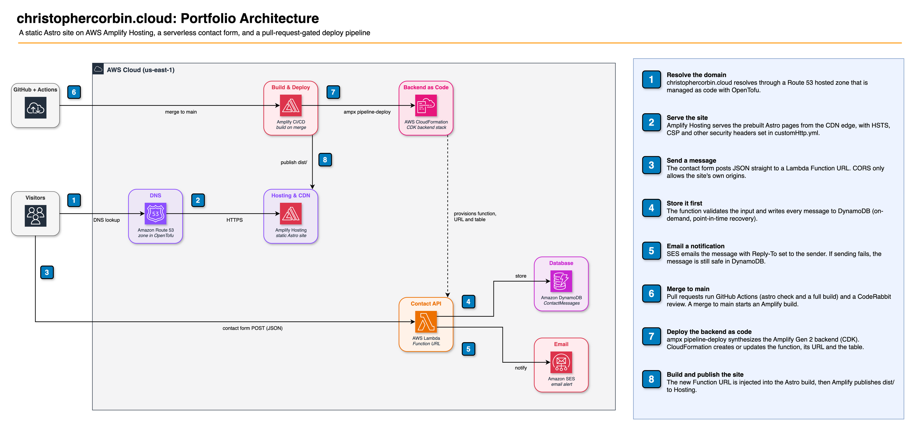

# eportfolio-v2

Portfolio and résumé site for Christopher Corbin, DevOps & Cloud Engineer.

**Live:** https://christophercorbin.cloud · **Résumé:** https://christophercorbin.cloud/resume



> The PNG embeds the editable diagram. Open `docs/architecture.drawio.png` in [draw.io](https://app.diagrams.net) to change it.

## How it works

**Serving (1–2).** `christophercorbin.cloud` resolves through a Route 53 hosted zone, managed as code with OpenTofu in a separate infrastructure repo. Amplify Hosting serves the prebuilt Astro pages from the CDN edge. Security headers (HSTS, CSP, `X-Frame-Options`, `Permissions-Policy`) and long-lived caching for hashed assets are set in [`customHttp.yml`](customHttp.yml).

**Contact form (3–5).** The form is the only client-side island (`ContactForm.tsx`). It posts JSON straight to a Lambda Function URL, and CORS only allows the site's own origins. The function validates the input and writes every message to DynamoDB first (on-demand, point-in-time recovery). Then SES emails it with Reply-To set to the sender. Email is best-effort: if SES fails, the message is still stored.

**Delivery (6–8).** Pull requests run the `verify` workflow in GitHub Actions (`astro check` and a full build) and get a CodeRabbit review. A merge to `main` starts an Amplify build ([`amplify.yml`](amplify.yml)):

1. `ampx pipeline-deploy` synthesizes the Amplify Gen 2 backend in [`amplify/`](amplify) (CDK), and CloudFormation creates or updates the function, its URL and the table.
2. [`scripts/write-contact-env.mjs`](scripts/write-contact-env.mjs) reads the new Function URL from `amplify_outputs.json` and passes it to the build as `PUBLIC_CONTACT_API_URL`.
3. `astro build` produces a static `dist/`, which Amplify publishes to Hosting.

## Stack

| Layer | Tech |
|---|---|
| Frontend | Astro 6, Tailwind CSS v4, React 19 (contact form island only) |
| Backend | Amplify Gen 2: TypeScript Lambda (Function URL), DynamoDB, SES |
| Hosting | AWS Amplify Hosting |
| DNS | Amazon Route 53, managed with OpenTofu |
| CI | GitHub Actions (type check + build), CodeRabbit review |

## Repository layout

```
src/
  data/content.ts    # all site and résumé copy, in one typed object
  components/        # one Astro component per section, plus ContactForm.tsx
  pages/             # index.astro, resume.astro
  styles/global.css  # Tailwind v4 @theme tokens and custom utilities
amplify/             # Gen 2 backend: contact-form function, table, Function URL
scripts/             # build helpers (contact URL injection, OG image)
public/              # images, badges, résumé assets
customHttp.yml       # security and cache headers at the CDN edge
docs/                # architecture diagram, design specs and plans
```

To change any copy on the site or the résumé, edit [`src/data/content.ts`](src/data/content.ts). Components only render it.

## Local development

Requires Node 22.12 or newer.

```bash
npm install
npm run dev       # http://localhost:4321
npm run build     # static build to dist/
npm run preview   # serve the built site
```

Without `amplify_outputs.json`, the build skips the contact API URL. The site still runs, but the form has nowhere to send.

## Project history

This is v2 of `christophercorbin.cloud`. v1 used a multi-account AWS setup with S3, CloudFront and a Python Lambda backend. v2 was rebuilt from scratch in May 2026 to:

1. Run from one account and one stack instead of several
2. Replace the hand-built S3, CloudFront and cross-account invalidation setup with Amplify Hosting
3. Move the frontend from vanilla HTML to Astro, Tailwind and components
4. Keep all infrastructure, DNS included, in code

Design rationale lives in [`docs/superpowers/specs/`](docs/superpowers/specs/).

## License

MIT
